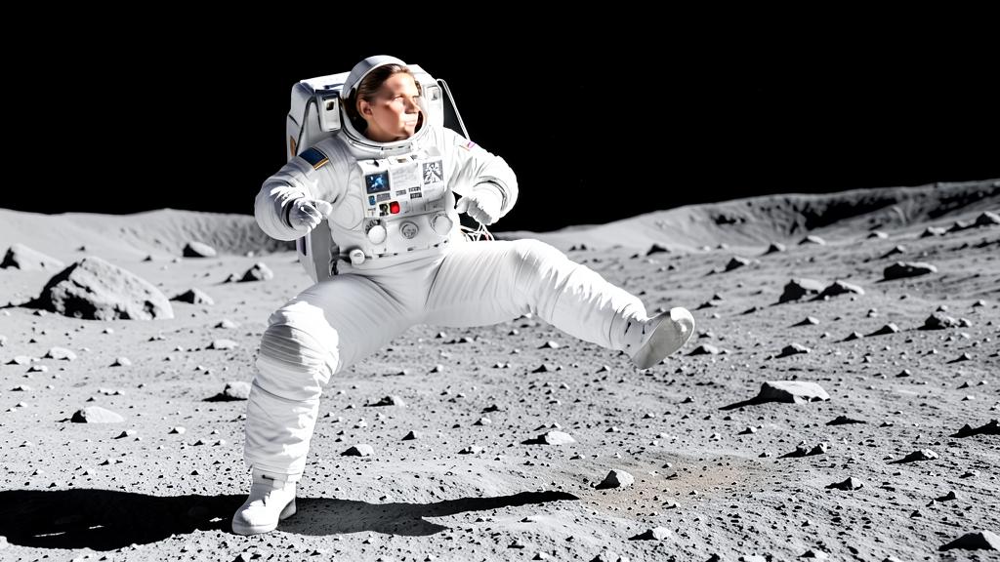
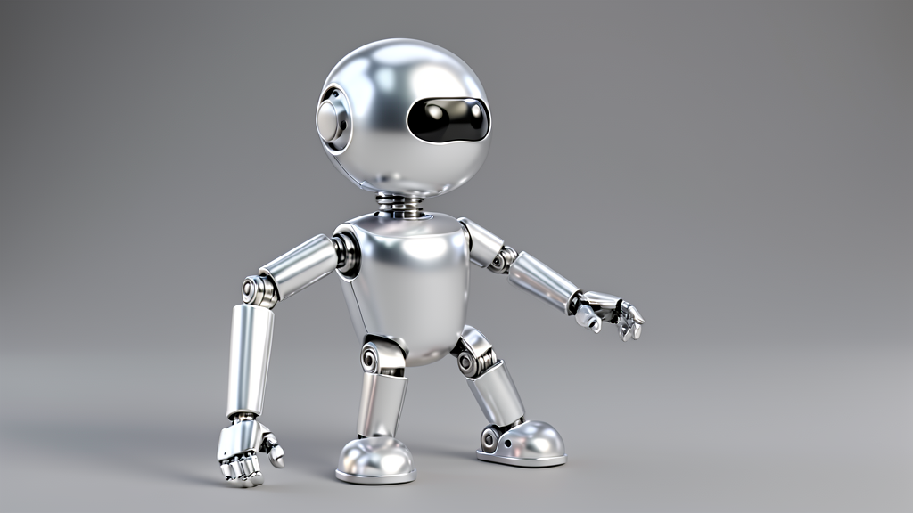
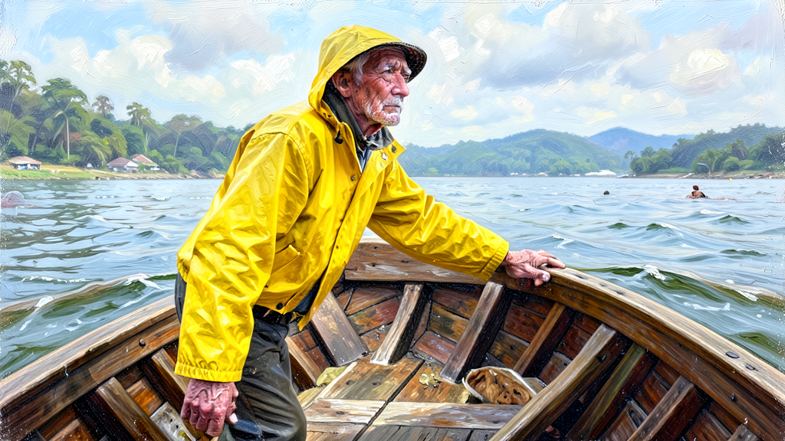
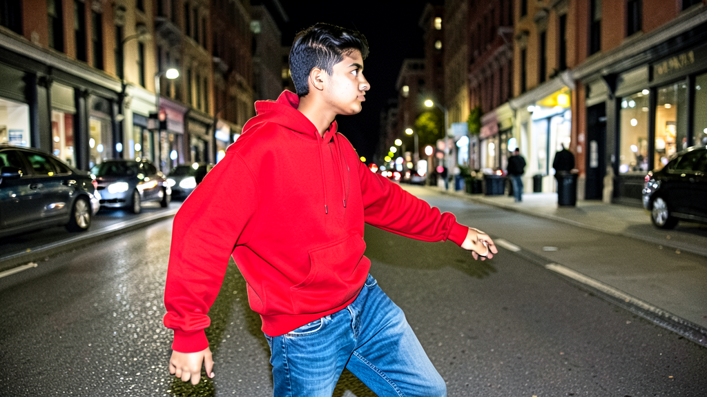
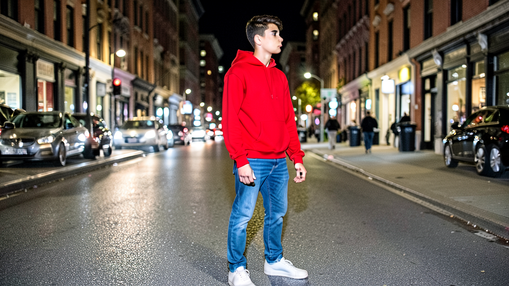
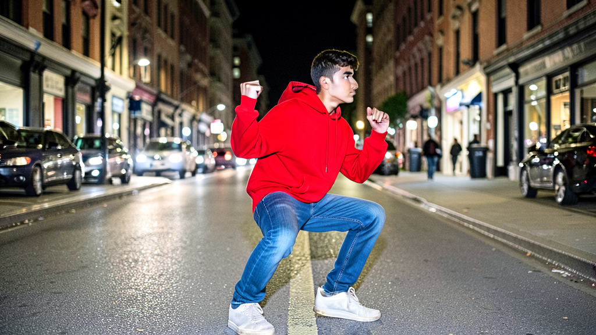

# 원하는 포즈로 이미지 만드는 도구

## 도구 설명
- 참조 사진에서 OpenPose로 관절(스켈레톤)을 뽑고, 그 스켈레톤을 조건으로 넣어 **같은 자세의 다른 인물·장면**을 만듭니다.
- 모델: FLUX.2-klein-4B (GGUF Q4, ComfyUI). 별도 ControlNet 모델 대신 FLUX.2의 참조 이미지 입력(`ReferenceLatent`)으로 스켈레톤을 넣습니다.

## 사용법
1. GitHub의 `pose_tool.ipynb`를 Colab에서 엽니다. (런타임 → T4 GPU)
2. 셀을 1번부터 순서대로 실행합니다. (설치 → 모델 다운로드 → 서버 실행 → 사진 업로드 → 포즈 추출 → 생성 → 저장)
3. `samples/`에서 참조 사진(`pose_0N.png`), 스켈레톤(`pose_0N_skeleton.png`), 결과(`output_0N.png`)를 확인합니다.

## 폴더 구조
```
pose-image-tool/
├── README.md
├── pose_tool.ipynb        # Colab 튜토리얼 노트
├── prompts.md             # 테스트에 쓴 프롬프트
└── samples/
    ├── pose_01.png            # 참조 사진
    ├── pose_01_skeleton.png   # OpenPose 스켈레톤
    ├── output_01.png          # 같은 자세로 만든 결과
    ├── compare_01.png         # 참조·스켈레톤·결과 비교
    ├── ... (02, 03)
    ├── exp_a_*.png            # 실험 A: 같은 포즈, 다른 프롬프트
    └── exp_b_*.png            # 실험 B: 다른 포즈, 같은 프롬프트
```

## 테스트 결과
같은 포즈, 다른 프롬프트
포즈 : 포즈 1(벤치프레스 자세)
- 프롬프트: astronaut on the moon → 결과: (서서 다리의 각도를 스켈레톤에 맞춘 자세)

- 프롬프트: medieval knight → 결과: (서서 팔의 각도를 스켈레톤에 맞춘 자세)

- 프롬프트: chef in a kitchen → 결과: (서서 팔의 각도를 스켈레톤에 맞춘 자세)


다른 포즈, 같은 프롬프트
프롬프트 : a young man in a red hoodie and blue jeans on a city street at night, photorealistic
- 포즈 1: (벤치프레스 자세) → 결과: (서서 팔을 벌리는 자세를 취함)

- 포즈 2: (데드리프트 서있는 자세) → 결과: (바벨을 없었으나 서있는 자세는 일치함)

- 포즈 3: (스쿼트 앉은 자세) → 결과: (바벨은 없었으나 스쿼트할 때 앉는 자세는 일치함)



## 한계
- **결과가 크게 달라진 쪽**: (프롬프트를 바꿨을 때, 포즈를 바꿨을때 모두 pose_1이 달라졌다)
- **잘 따라온 것**: (전체적인 자세는 좋았음. 자세 자체가 세부적인 동작이 아니라 큰 동장을 잘 따라옴)
- **잘 안 따라온 것**: (누워있는 자세는 스켈레톤 선이 몸통인지 팔인지 다리인지 구분하지 못하는것 같음)
- **포즈와 프롬프트가 부딪힐 때**: (로봇처럼 사람 체형이 아닐때 사람을 따라갔으나 각도가 살짝 다름)
- **한계와 개선 아이디어**: (스켈레톤 선이 단순한것은 제대로 구현하지 못했다)
